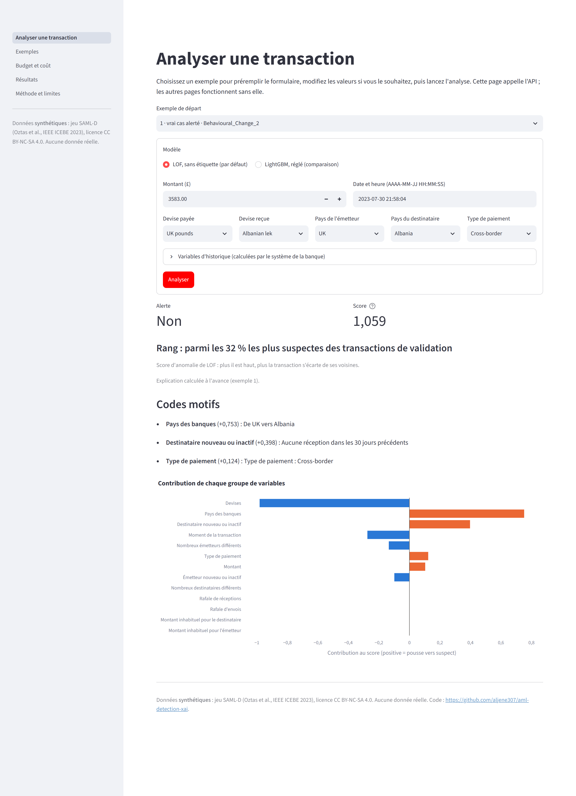
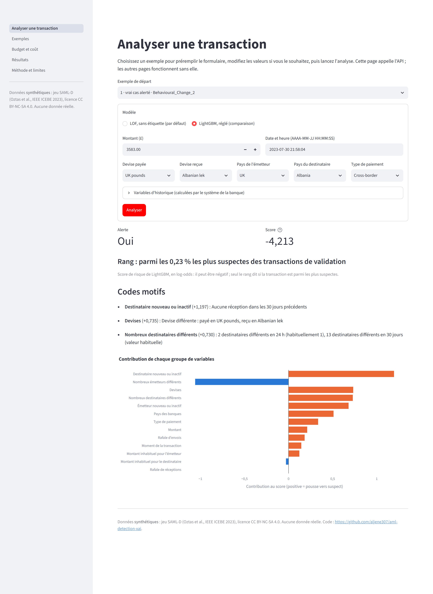
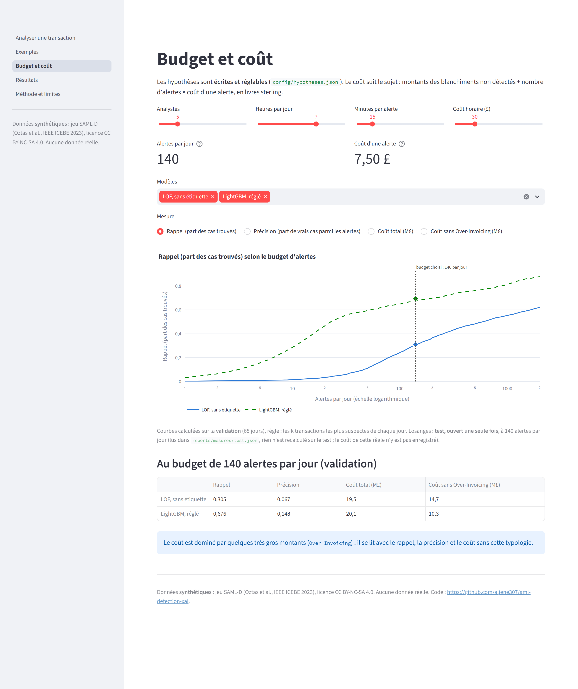
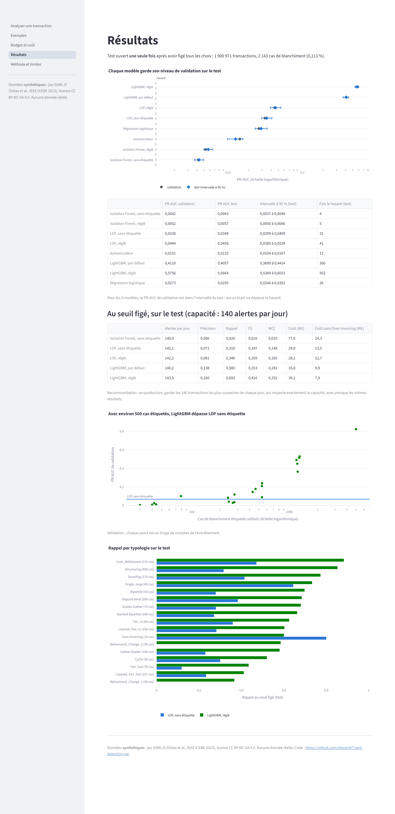
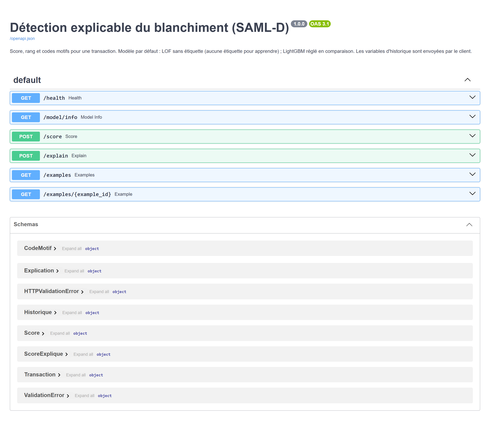

# Détection explicable du blanchiment d'argent (SAML-D)

> **Données synthétiques.** Toutes les transactions de ce projet viennent du jeu public
> SAML-D, généré par simulation (Oztas et al., IEEE ICEBE 2023, licence CC BY-NC-SA 4.0).
> Aucune donnée bancaire réelle n'est utilisée.

Projet Challenge 2 — Data Mining, ENSI, filière II3-IF, 2026-2027.
Auteur : Mohamed Aljene.

Le projet repère des transactions suspectes de blanchiment **sans utiliser d'étiquettes pour
apprendre** (LOF et Isolation Forest), mesure ce que l'on perd par rapport à un modèle
supervisé (LightGBM), fixe un seuil d'alerte par un coût et une capacité d'équipe, et explique
chaque alerte par des **codes motifs** lisibles (SHAP).

- **API en ligne** : https://aml-detection-xai-api.onrender.com (documentation interactive :
  [/docs](https://aml-detection-xai-api.onrender.com/docs)). Service gratuit : le premier appel
  après une période sans activité prend environ une minute.
- **Application Streamlit** : lien ajouté après sa mise en ligne.
- **Journal de tous les choix, avec leurs raisons et leurs mesures** : [docs/CHOIX.md](docs/CHOIX.md).
- **Notebook complet** (sections 1 à 8) : [notebooks/projet_aml.ipynb](notebooks/projet_aml.ipynb).
- **Synthèse d'une page** : [reports/synthese.pdf](reports/synthese.pdf).

## Résultats clés (test, ouvert une seule fois)

Tous les choix (modèles, réglages, seuils, hypothèses de coût) ont été figés et poussés sur
GitHub **avant** d'ouvrir le test (`docs/CHOIX.md`, section 29). Test : 1 900 971 transactions,
2 143 cas de blanchiment (0,113 %), du 19/06/2023 au 23/08/2023.

- **Sans étiquette, LOF fait environ 31 fois mieux que le hasard ; avec étiquettes, LightGBM
  réglé fait environ 500 fois mieux** (PR-AUC 0,035 et 0,566, contre 0,0011 pour le hasard).
- Pour les 8 modèles, la PR-AUC de validation est dans l'intervalle à 95 % du test : **aucun
  écart entre validation et test ne dépasse le hasard**.
- Courbe d'apprentissage (validation) : avec environ 500 cas de blanchiment étiquetés,
  LightGBM par défaut dépasse LOF sans étiquette à chaque tirage.

| Modèle | Étiquettes | PR-AUC (test) | Précision | Rappel | F2 | MCC |
|---|---|---|---|---|---|---|
| Isolation Forest | aucune | 0,0043 | 0,006 | 0,026 | 0,016 | 0,010 |
| **LOF** | **aucune** | **0,0348** | 0,072 | 0,310 | 0,187 | 0,148 |
| LOF, réglé | validation (réglage) | 0,0458 | 0,081 | 0,346 | 0,209 | 0,165 |
| LightGBM, par défaut | entraînement | 0,4057 | 0,138 | 0,580 | 0,353 | 0,281 |
| LightGBM, réglé | entraînement + validation | 0,5664 | 0,160 | 0,692 | 0,416 | 0,331 |

Précision, rappel, F2 et MCC : au seuil figé sur la validation, prévu pour 140 alertes par jour
(5 analystes, 7 h par jour, 15 min par alerte). Sur le test, les 5 modèles à seuil **dépassent
légèrement cette capacité** : de 140,2 à 143,5 alertes par jour (de 9 046 à 9 259 alertes pour
9 035 possibles), car un seuil fixe suit la dérive des scores. **Recommandation** : en
production, garder les 140 transactions les plus suspectes de chaque jour, ce qui respecte
exactement la capacité avec presque les mêmes résultats (LightGBM réglé : précision 0,160,
rappel 0,692 ; LOF : précision 0,071, rappel 0,308).

Les 3 autres modèles (Isolation Forest réglé, autoencodeur, régression logistique) sont dans
[reports/mesures/test.json](reports/mesures/test.json), avec les intervalles. La régression
logistique, **avec** étiquettes, fait moins bien que LOF **sans** étiquette (PR-AUC 0,0293 contre
0,0348) : les étiquettes ne suffisent pas sans un modèle qui combine les variables.

## Captures

**Analyser une transaction avec LOF (sans étiquette)** : alerte, rang parmi les transactions de
validation, codes motifs et contribution de chaque groupe de variables.



**La même transaction avec LightGBM** (comparaison, explication calculée en direct).



**Budget et coût** : hypothèses réglables, rappel selon le nombre d'alertes par jour
(validation), point du test à 140 alertes par jour.



**Résultats** : validation et test pour les 8 modèles, mesures au seuil, courbe
d'apprentissage, rappel par typologie.



**API** : documentation interactive des 6 endpoints.



## Démarche

1. **Variables** calculées sur l'historique complet de chaque compte, en ne regardant que le
   passé `[t − fenêtre ; t[` (compteurs sur 1 h et 24 h, rapport au montant moyen sur 30 jours,
   contreparties distinctes, temps depuis la transaction précédente).
2. **Séparation chronologique** : entraînement 60 %, validation 20 %, test 20 %.
3. **Méthodes sans étiquette** : Isolation Forest et LOF (deuxième méthode choisie par une règle
   de coût, sans étiquettes), en version par défaut et en version réglée sur la validation.
4. **Comparaison supervisée** : LightGBM, avec la régression logistique comme contrôle. Le
   traitement du déséquilibre (aucun, pondération des classes ou sous-échantillonnage) a été
   choisi par une règle fixée à l'avance, un bootstrap apparié sur la validation : ni la
   pondération ni le sous-échantillonnage n'ont battu l'absence de traitement dans un seul
   tirage.
5. **Seuil** : coût minimal sous la capacité de l'équipe. Coût = montants des blanchiments non
   détectés + nombre d'alertes × coût d'une alerte, en livres sterling.
6. **Explications** : SHAP regroupé en 13 codes motifs, au plus 3 par alerte, avec une phrase
   qui donne la vraie valeur et la valeur habituelle.
7. **Test** ouvert une seule fois, après avoir figé et poussé tous les choix.

## Limites

- **Données synthétiques** : les résultats ne disent pas comment les méthodes se comporteraient
  sur de vraies données bancaires.
- Le coût est dominé par quelques très gros montants, surtout `Over-Invoicing` (environ 68 % du
  montant blanchi du test pour 10 cas) : il se lit avec la précision, le rappel, le F2 et le MCC.
- Les explications ne sont pas fidèles selon la règle fixée avant les mesures (test de
  suppression) ; elles restent cohérentes avec les typologies.
- Les changements de comportement d'un compte échappent à LOF.

Toutes les limites et leurs mesures : [docs/CHOIX.md](docs/CHOIX.md).

## Installation (Windows PowerShell, Python 3.11)

`py -3.11` suppose que Python 3.11 est installé (lanceur `py` de Windows).

```powershell
git clone https://github.com/aljene307/aml-detection-xai.git
cd aml-detection-xai
py -3.11 -m venv .venv
.\.venv\Scripts\python.exe -m pip install --upgrade pip
.\.venv\Scripts\python.exe -m pip install -r requirements-dev.txt
```

Toutes les versions sont figées. `requirements-api.txt` sert à l'API (Render),
`app/requirements.txt` à l'application (Streamlit Community Cloud).

## Lancer l'API et l'application en local

Ces deux commandes n'ont pas besoin du jeu de données : les modèles et les exemples sont dans
le dépôt.

```powershell
.\.venv\Scripts\python.exe -m uvicorn api.main:app --port 8000
```

Puis ouvrir http://127.0.0.1:8000/docs. Dans un autre terminal :

```powershell
.\.venv\Scripts\python.exe -m streamlit run app\streamlit_app.py
```

L'application appelle par défaut l'API en ligne. Pour utiliser l'API locale, définir la
variable `API_URL` **dans le même terminal**, avant de lancer Streamlit :

```powershell
$env:API_URL = "http://127.0.0.1:8000"
```

## Tests

```powershell
.\.venv\Scripts\python.exe -m pytest -q
```

## Reproduire tous les résultats

Le jeu est public : **aucune clé ni aucun jeton n'est nécessaire** pour le télécharger
(`kagglehub`). Il faut environ 4 Go d'espace disque. La plupart des étapes restent sous 2 Go de
mémoire, mais la préparation du test (`scripts\prepare_test.py`) monte jusqu'à environ 4,7 Go :
prévoir 5 Go de mémoire libre pour cette étape. La reconstruction complète prend plusieurs
heures (les étapes de LOF sont les plus longues).

```powershell
# Données et contrôles de qualité
.\.venv\Scripts\python.exe scripts\download_data.py
.\.venv\Scripts\python.exe scripts\check_quality.py

# Variables, effectifs, effet de démarrage, codage par fréquence
.\.venv\Scripts\python.exe scripts\build_features.py
.\.venv\Scripts\python.exe scripts\analyze_features.py --cas periodes
.\.venv\Scripts\python.exe scripts\analyze_features.py --cas demarrage
.\.venv\Scripts\python.exe scripts\analyze_features.py --cas frequences

# Méthodes sans étiquette : matrice, faisabilité, grilles et contrôles
# (les grilles reprennent après les réglages déjà écrits : on met de côté ceux du dépôt)
.\.venv\Scripts\python.exe scripts\train_unsupervised.py --cas matrice
.\.venv\Scripts\python.exe scripts\train_unsupervised.py --cas faisabilite --methode isolation_forest
.\.venv\Scripts\python.exe scripts\train_unsupervised.py --cas faisabilite --methode lof
.\.venv\Scripts\python.exe scripts\train_unsupervised.py --cas faisabilite --methode autoencodeur
.\.venv\Scripts\python.exe scripts\train_unsupervised.py --cas regle
Move-Item reports\mesures\grilles.jsonl reports\mesures\grilles_depot.jsonl
.\.venv\Scripts\python.exe scripts\tune_unsupervised.py --cas grilles
.\.venv\Scripts\python.exe scripts\tune_unsupervised.py --cas graines_lof
.\.venv\Scripts\python.exe scripts\tune_unsupervised.py --cas tableau
.\.venv\Scripts\python.exe scripts\tune_unsupervised.py --cas petit_echantillon
.\.venv\Scripts\python.exe scripts\tune_unsupervised.py --cas one_hot
.\.venv\Scripts\python.exe scripts\tune_unsupervised.py --cas ex_aequo

# Modèle supervisé, évaluation au seuil, explications
# (même reprise que les grilles, et la décision sur le déséquilibre serait relue)
Move-Item reports\mesures\supervise.jsonl reports\mesures\supervise_depot.jsonl
Move-Item reports\mesures\desequilibre.json reports\mesures\desequilibre_depot.json
.\.venv\Scripts\python.exe scripts\train_supervised.py --cas tout
.\.venv\Scripts\python.exe scripts\train_supervised.py --cas tableau
.\.venv\Scripts\python.exe scripts\evaluate.py
.\.venv\Scripts\python.exe scripts\explain.py --cas modele
.\.venv\Scripts\python.exe scripts\explain.py --cas explications

# Test : préparation, répétition sur la validation, puis ouverture
.\.venv\Scripts\python.exe scripts\prepare_test.py
.\.venv\Scripts\python.exe scripts\evaluate_test.py --periode validation
Move-Item reports\mesures\test.json reports\mesures\test_depot.json
.\.venv\Scripts\python.exe scripts\evaluate_test.py

# Fichiers de l'API et de l'application, puis le notebook
.\.venv\Scripts\python.exe scripts\build_api_artifacts.py
.\.venv\Scripts\python.exe scripts\build_app_data.py
.\.venv\Scripts\python.exe -m nbconvert --to notebook --execute --inplace notebooks\projet_aml.ipynb
.\.venv\Scripts\python.exe scripts\clean_notebook.py

# Comparer les résultats reconstruits avec ceux du dépôt (durées et mémoire ignorées)
.\.venv\Scripts\python.exe scripts\compare_results.py reports\mesures\test_depot.json reports\mesures\test.json
.\.venv\Scripts\python.exe scripts\compare_results.py reports\mesures\grilles_depot.jsonl reports\mesures\grilles.jsonl
.\.venv\Scripts\python.exe scripts\compare_results.py reports\mesures\supervise_depot.jsonl reports\mesures\supervise.jsonl
.\.venv\Scripts\python.exe scripts\compare_results.py reports\mesures\desequilibre_depot.json reports\mesures\desequilibre.json
git diff --stat
```

Pourquoi ces déplacements : `scripts\evaluate_test.py` refuse de tourner si
`reports\mesures\test.json` existe déjà (le test du projet n'a été ouvert qu'une fois) ; les
grilles et le modèle supervisé reprennent après les calculs déjà écrits, et ne recalculeraient
rien. Les autres fichiers de résultats sont réécrits : `git diff --stat` montre ceux qui ont
changé par rapport au dépôt.

Utiliser `python -m nbconvert` et non `python -m jupyter nbconvert` : sans environnement activé,
cette dernière peut lancer un autre Python installé sur le poste.

## Organisation du dépôt

| Dossier | Contenu |
|---|---|
| `src/aml_xai/` | code partagé : données, variables, matrice, modèles, évaluation, explications, service de l'API |
| `scripts/` | une étape par script (téléchargement, variables, modèles, évaluation, test, captures) |
| `api/` | API FastAPI |
| `app/` | application Streamlit |
| `config/` | hypothèses de coût, codes motifs, choix figés avant le test |
| `models/` | modèles servis par l'API et paramètres appris (avec leurs empreintes SHA-256) |
| `reports/mesures/` | toutes les mesures, en JSON |
| `data/demo/` | 30 transactions d'exemple (sous licence CC BY-NC-SA 4.0) |
| `notebooks/` | le notebook du projet |
| `docs/` | journal des choix et captures |
| `tests/` | tests automatiques |

## Données et licences

- **Données synthétiques** : *Anti Money Laundering Transaction Data (SAML-D)*, Berkan Oztas,
  [Kaggle](https://www.kaggle.com/datasets/berkanoztas/synthetic-transaction-monitoring-dataset-aml).
  Jeu généré par simulation : aucune transaction réelle.
- Licence des données : [CC BY-NC-SA 4.0](https://creativecommons.org/licenses/by-nc-sa/4.0/).
  Tout extrait commité dans `data/demo/` reste sous cette licence.
- Référence : B. Oztas, D. Cetinkaya, F. Adedoyin, M. Budka, H. Dogan et G. Aksu,
  « Enhancing Anti-Money Laundering: Development of a Synthetic Transaction
  Monitoring Dataset », IEEE ICEBE 2023, pp. 47-54,
  doi:[10.1109/ICEBE59045.2023.00028](https://doi.org/10.1109/ICEBE59045.2023.00028).
- Code sous licence MIT (voir [LICENSE](LICENSE)).
